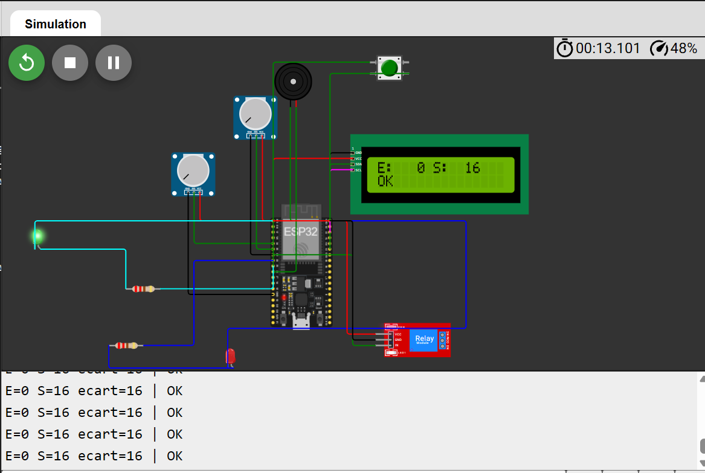
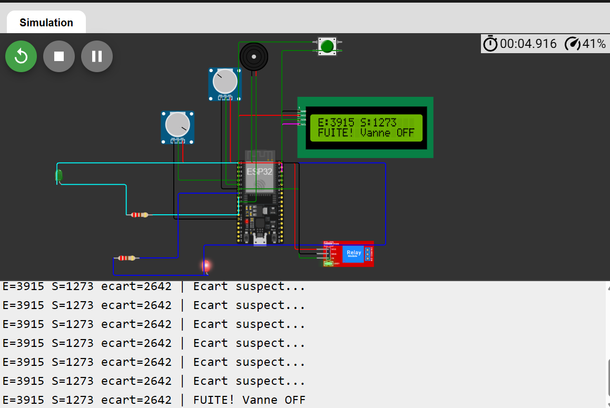

# 💧 Détecteur de fuite d'eau — ESP32

Système embarqué qui **détecte une fuite d'eau** dans une canalisation en comparant le débit d'entrée et le débit de sortie, **déclenche une alarme** et **coupe automatiquement l'arrivée d'eau** grâce à une électrovanne.

▶️ **Simulation en ligne (Wokwi) :** https://wokwi.com/projects/475494496552828929

| État normal | Fuite détectée |
|:---:|:---:|
|  |  |

---

## 🧠 Principe

Un débitmètre est placé à l'**entrée** de la canalisation, un autre à la **sortie**.
En fonctionnement normal, toute l'eau qui entre ressort : les deux débits sont égaux.
Si une partie de l'eau s'échappe entre les deux (fissure, raccord défectueux…), un **écart** apparaît.

> Si `|débit entrée − débit sortie| > seuil` pendant plus de 3 secondes → **fuite confirmée**.

C'est le principe du **bilan de débit**, utilisé pour surveiller les réseaux d'eau (habitations, immeubles, irrigation).

---

## 🔧 Matériel

| Composant | Rôle | Broche ESP32 |
|---|---|---|
| ESP32 DevKit C V4 | Microcontrôleur | — |
| Potentiomètre ×2 | Simulent les débitmètres d'entrée et de sortie | GPIO 34, GPIO 35 |
| Écran LCD 16x2 I2C (0x27) | Affichage des débits et de l'état | SDA 21, SCL 22 |
| Buzzer | Alarme sonore | GPIO 26 |
| Bouton poussoir | Acquittement / réarmement (pull-up interne) | GPIO 27 |
| LED verte + résistance 220 Ω | Système OK | GPIO 25 |
| LED rouge + résistance 220 Ω | Suspicion (clignote) / fuite (fixe) | GPIO 33 |
| Module relais | Commande de l'électrovanne | GPIO 32 |

Bibliothèque : `LiquidCrystal I2C`

> En version réelle, les potentiomètres seraient remplacés par des débitmètres à effet Hall (ex. YF-S201) et le relais piloterait une électrovanne 12 V.

---

## ⚙️ Fonctionnement — machine à états

```
           écart > seuil                 écart > seuil            appui
 NORMAL ─────────────────► SUSPICION ──── pendant 3 s ───► ALARME ───────► ACQUITTÉE
   ▲                           │                                              │
   │      écart redevient      │                                              │
   └────────── normal ─────────┘                                              │
   └────────────────────── 2ᵉ appui (réparation effectuée) ───────────────────┘
```

| État | LCD | LED | Buzzer | Vanne |
|---|---|---|---|---|
| NORMAL | `OK` | 🟢 verte | — | ouverte |
| SUSPICION | `Ecart suspect...` | 🔴 clignote | — | ouverte |
| ALARME | `FUITE! Vanne OFF` | 🔴 fixe | 🔊 1 kHz | **fermée** |
| ACQUITTÉE | `Reparer + bouton` | 🔴 fixe | — | **fermée** |

**Choix de conception :**
- **Confirmation temporisée (3 s)** : évite les fausses alertes dues à un pic ponctuel.
- **Réarmement manuel** : une fois la vanne fermée, les deux débits tombent à zéro et l'écart disparaît alors que la fuite est toujours là. Le système ne rouvre donc jamais l'eau seul : c'est l'utilisateur qui confirme la réparation (principe de sécurité).
- **Programmation non bloquante** : gestion du temps avec `millis()` au lieu de `delay()`, pour que le bouton reste réactif en permanence.
- **Détection de front + anti-rebond logiciel** sur le bouton : un appui = une seule action.
- **Affichage sans scintillement** : lignes de 16 caractères formatées avec `snprintf` au lieu de `lcd.clear()`.

---

## ▶️ Tester la simulation

1. Ouvrir le [projet Wokwi](https://wokwi.com/projects/475494496552828929) et lancer la simulation.
2. Mettre les deux potentiomètres à la même position → `OK`, LED verte.
3. Les écarter → LED rouge clignotante, puis après 3 s : alarme, buzzer, relais activé (vanne fermée).
4. Appuyer sur le bouton → le buzzer se tait, la vanne reste fermée.
5. Remettre les potentiomètres au même niveau puis appuyer à nouveau → retour à l'état normal.

---

## 📁 Fichiers

| Fichier | Contenu |
|---|---|
| `sketch.ino` | Code du programme |
| `diagram.json` | Schéma du montage Wokwi |
| `libraries.txt` | Bibliothèques utilisées |
| `wokwi-project.txt` | Lien vers le projet Wokwi |

---

## 🚀 Améliorations possibles

- Alerte à distance via Wi-Fi (notification Telegram ou page web)
- Version physique avec de vrais débitmètres YF-S201 (comptage d'impulsions)
- Détection d'anomalies par apprentissage automatique (TinyML) au lieu d'un seuil fixe

---

**Auteur :** Ahmed Ben Youssef — étudiant ingénieur en électronique et systèmes embarqués, Polytech Nice Sophia
